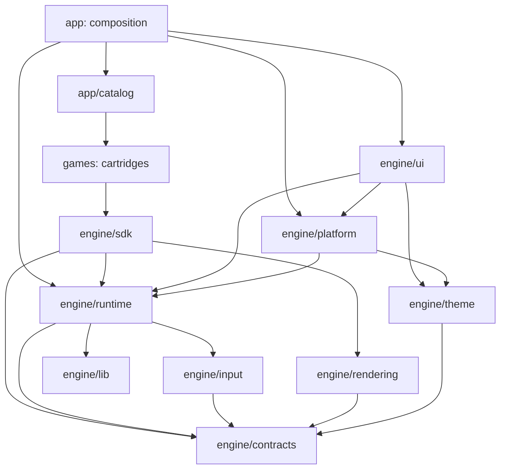

# Карта кода и зависимости

Проект организован по ответственности модулей: **app → engine ← games**. Это модульная архитектура с публичным SDK, а не полный Feature-Sliced Design. Из FSD здесь полезны явные границы и направленные зависимости; отдельные pages/entities/widgets не соответствуют устройству небольшого игрового хоста. [Правила слоёв FSD](https://feature-sliced.design/docs/reference/layers).

## Дерево

```text
src/
├── main.ts                       # точка входа: загружает app/bootstrap
├── app/
│   ├── bootstrap.ts              # связывает контроллеры и запускает приложение
│   └── catalog.ts                # регистрирует конкретные игры
├── engine/
│   ├── sdk.ts                    # единственная публичная граница для игр
│   ├── contracts/                # декларации, без исполняемого кода
│   │   ├── game.ts               # state, actions, rules, render frame, HUD
│   │   ├── cartridge.ts          # definition, metadata, codec
│   │   ├── settings.ts           # схема полей, presets, эффекты Apply
│   │   └── visuals.ts            # семантическая палитра
│   ├── runtime/
│   │   ├── session.ts            # тики, скорость, владение вводом, история, откат
│   │   ├── session/              # types, playback clock, recovery history
│   │   ├── cartridge.ts          # engine runtime, копии defaultState, Apply
│   │   ├── cartridge/            # types и проверка конфигурации
│   │   ├── registry.ts           # raw definitions → изолированные runtime-экземпляры
│   │   ├── settings-validation.ts# общая проверка полей схемы
│   │   └── recovery.ts           # ограниченная проверка жизнеспособности
│   ├── input/
│   │   ├── actions.ts            # системные команды, роли и конфликты привязок
│   │   ├── keyboard.ts           # браузерная клавиатура → engine/game inputs
│   │   └── lib/key-normalization.ts
│   ├── rendering/                # Canvas helpers, feedback и fallback visuals
│   ├── theme/
│   │   ├── appearance.ts         # чистый resolver палитры
│   │   ├── preferences.ts        # нормализация темы/акцента
│   │   ├── tokens.ts             # вычисление семантических CSS tokens
│   │   └── lib/color.ts          # цветовая математика и контраст
│   ├── platform/
│   │   ├── storage.ts            # browser storage, конверт сохранения
│   │   └── appearance.ts         # применение resolved theme к DOM
│   ├── ui/
│   │   ├── controls/             # подсказки, touch pad, системная панель, speed select
│   │   ├── library/              # поиск, карточки и навигация библиотеки
│   │   ├── settings/             # form, draft hooks, поля, preview и media
│   │   ├── board/                # HUD, размеры viewport и DOM-подписи
│   │   ├── primitives/           # установленный shadcn/Base UI
│   │   ├── styles/               # CSS entrypoints; arcade/ по зонам интерфейса
│   │   ├── lib/                  # небольшие helpers только для UI
│   │   ├── icons.ts              # иконки оболочки
│   │   └── panels.ts             # жизненный цикл диалогов и возврат фокуса
│   └── lib/random.ts             # чистый детерминированный PRNG
├── games/
│   ├── snake/                    # index собирает state/logic/AI/render/settings/codec
│   └── tetris/                   # такой же независимый картридж
└── tests/
    ├── architecture/             # рекурсивная проверка импортов и чистоты слоёв
    └── integration/              # общие сценарии на настоящих играх
```

Тесты отдельного модуля лежат в `__tests__` рядом с владельцем кода: например, `engine/runtime/cartridge.ts` и `engine/runtime/__tests__/cartridge.test.ts`, либо `games/snake/logic.ts` и `games/snake/__tests__/logic.test.ts`. Общие архитектурные и межмодульные интеграционные проверки остаются в `src/tests`. Интеграционные тесты, которым нужны и Session, и конкретные игры, вынесены из engine: в production движок о картриджах не знает. Разбиение игр сохраняет прежние алгоритмы.

## Внутри игры

`index.ts` — явная точка сборки с `export default { ... } satisfies GameDefinition<...>`. Короткие callbacks, метрики и конфигурация находятся прямо в объекте; объёмные алгоритмы подключаются из отдельных модулей. Внутренний файл экспортирует один runtime-объект, потребитель импортирует его default-импортом. Типы идут отдельным `import type`; `types.ts` содержит только типы. Мелкие приватные helpers остаются рядом с алгоритмом, а не превращаются каждый в отдельный файл.

| Файл                        | Ответственность                                                |
| --------------------------- | -------------------------------------------------------------- |
| index.ts                    | Metadata, связывание модулей, configure, лёгкие callbacks      |
| types.ts                    | Форма состояния, настроек и предметных сущностей               |
| state.ts                    | Нулевой JSON-шаблон defaultState; текущего состояния здесь нет |
| board.ts                    | Размеры, геометрия, координаты, столкновения и повороты        |
| logic.ts                    | Чистые initialize/update и их приватные helpers                |
| ai.ts или ai/               | Выбор действий; в Snake поиск разбит по алгоритмам             |
| render.ts                   | Геометрия изображения и применение SDK-палитры                 |
| controls.ts                 | Декларации игровых действий                                    |
| settings.ts                 | Схема, normalize/validate/effect и presets                     |
| persistence.ts              | Версия, decode и проверка совместимости сохранения             |
| preview.ts, clear-effect.ts | Необязательные отдельные задачи представления                  |

Это ориентиры по ответственности, а не обязательный набор пустых файлов для каждой новой игры. У маленькой игры всё определение может уместиться в `index.ts`.

Snake `preview.ts` хранит лишь координаты шести сегментов и направление рисунка. Это не `SnakeState`, не `defaultState` и не снимок партии: там нет score, RNG, еды или флагов завершения. Он использует ту же геометрию тела из `body-render.ts`, а движок передаёт Canvas и тему. Нулевой шаблон отдельно находится в `state.ts`, живая партия — только в engine Session.

## Оболочка приложения

`bootstrap.ts` связывает готовые сервисы, а не реализует их внутри себя. `workspace.ts` отвечает за выбор игры, сохранения, best score и общую скорость. `routing.ts` читает и обновляет shareable URL. Контроллеры `input`, `library`, `settings` и `focus` связывают engine с пользовательскими действиями. `presentation.ts` передаёт view model в HUD и обновляет поле, `browser-events.ts` привязывает события, `frame-loop.ts` планирует кадры. Во всех случаях текущим игровым state продолжает владеть Session.

## Именование и размер модулей

- Файлы называются в `kebab-case`; общие типы внутри зоны лежат в `types.ts`, React hooks — `use-*.ts`, тесты — `__tests__/*.test.ts(x)`.
- `contracts/` — отдельный слой только типов: имена game/settings/visuals обозначают доменные контракты, а не произвольные модели. Частные короткие типы аргументов остаются рядом с функцией/компонентом.
- Утилиты называются по задаче и живут в `lib/` своего владельца, например `key-normalization.ts` или `color.ts`. Универсального склада `helpers` нет; `ui/lib/utils.ts` сохраняет стандартный путь для shadcn `cn`.
- Ориентир 30–100 строк помогает заметить смешанные обязанности, но не служит лимитом. Session, поиск и цельный renderer могут быть длиннее. Маленькие entrypoint, каталог, шаблон state или SDK façade могут быть короче. Скопированные primitives сохраняют библиотечную структуру. `styles/arcade.css` перечисляет CSS-зоны в исходном порядке каскада: foundation/header/board/sidebar, transport/library/controls, desktop/mobile и viewport/motion.
- Сложные условия группируются в проверки с предметными именами; варианты поведения и длинные тексты — в конфигурации/таблицы. Мелкие helpers остаются приватными в том же файле.
- `bun run format` форматирует код, конфиги и документацию; `bun run check` включает `format:check`. Скопированные shadcn primitives, зависимости, build outputs и защищённые skill-файлы исключены через `.prettierignore`.

## Разрешённые зависимости

| Зона       | Может зависеть от                                             |
| ---------- | ------------------------------------------------------------- |
| contracts  | Других contracts, только type imports                         |
| lib        | Локальных чистых алгоритмов и contracts                       |
| input      | input и contracts; keyboard адаптирует DOM-события            |
| runtime    | runtime, contracts, input, lib                                |
| rendering  | rendering и contracts                                         |
| theme      | theme и contracts; никаких DOM/media запросов                 |
| platform   | platform, contracts, runtime, theme                           |
| ui         | Сервисов движка, primitives и UI-библиотек; никаких games/app |
| sdk        | contracts, runtime, rendering, lib; не browser/UI adapters    |
| games/<id> | Собственных файлов и `@/engine/sdk`                           |
| app        | engine и catalog; concrete games импортирует только catalog   |

Внутренние модули engine используют прямые импорты, а не собственный SDK barrel. Это избегает обратных связей и циклов. Primitives зависят только от других primitives/UI helpers и внешних UI-пакетов, не от игрового runtime или формы настроек.



Схема показывает основные связи, таблица — полный разрешённый набор. Публичный `games/<id>/index.ts` экспортирует один plain default-объект определения: metadata/defaultState/settings/persistence/initialize/configure. Вызовов фабрик и текущего состояния внутри него нет. Каталог перечисляет определения; `app/bootstrap` создаёт engine `createRegistry`, в котором живут изменяемые settings и Session. Шаблон defaultState глубоко копируется для каждой новой партии. Игры не импортируют собственный index из внутренних модулей.

Слой `app` связывает DOM, runtime и каталог; `bootstrap.ts` — его composition root. Низкоуровневые функции живут у владельцев ответственности. Общая папка helpers/utils для произвольного кода не создаётся; `lib` в зоне содержит только её узкие вспомогательные алгоритмы.

## Где менять

| Задача                                         | Начать с                                                                      |
| ---------------------------------------------- | ----------------------------------------------------------------------------- |
| Добавить игру                                  | [SDK guide](engine-sdk.md), games/<id>/index.ts, app/catalog.ts               |
| Изменить паузу, скорость, откат                | engine/runtime/session.ts                                                     |
| Добавить общий тип или callback                | engine/contracts + engine/sdk.ts                                              |
| Изменить клавиши/проверку ролей                | engine/input/actions.ts                                                       |
| Изменить группировку Move или мобильные кнопки | engine/ui/controls/control-layout.ts                                          |
| Добавить общий тип настройки                   | contracts/settings.ts, runtime/settings-validation.ts, ui/settings/fields.tsx |
| Поменять тему или палитру                      | engine/theme/appearance.ts; цветовую математику — theme/lib/color.ts          |
| Изменить сохранения                            | platform/storage.ts; формат игрового state — codec внутри games/<id>          |
| Поменять диалоги и компоненты                  | engine/ui; shadcn CLI уже настроен на ui/primitives                           |
| Проверить границы                              | tests/architecture; запускаются обычным `bun run check`                       |

[Полный контракт SDK](engine-sdk.md) и [устройство формы настроек](settings-ui.md) описывают поведение. Этот документ отвечает за расположение файлов и направление зависимостей.
